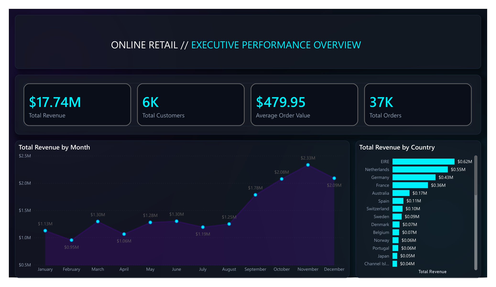
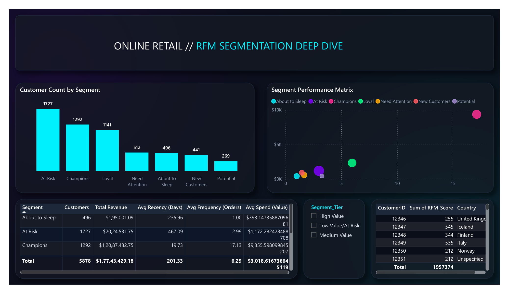
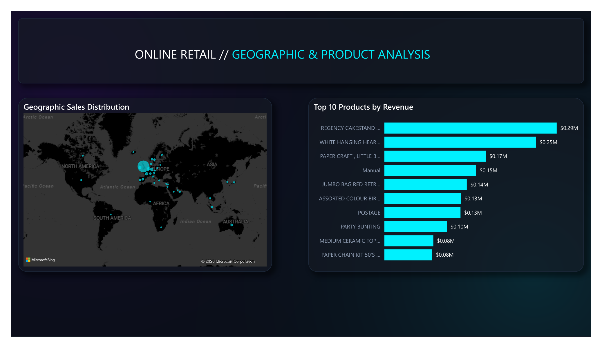
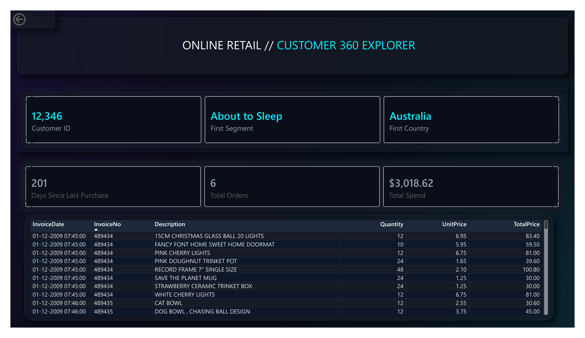

# 🛍️ Customer Segmentation & RFM Analysis Dashboard

> **Project Status:** Completed (April 24, 2024) | **Maintainer:** R Vikram

## 1. Project Title & Overview
**Customer Segmentation & RFM Behavioral Intelligence** is an advanced marketing analytics and customer valuation system built on the UCI Machine Learning Online Retail II dataset. Processing 805,549 transactions, the project calculates Recency, Frequency, and Monetary (RFM) metrics to segment customers into actionable behavioral cohorts, powering automated retention and VIP loyalty workflows.

---

## 2. Business Problem
Treating all customers uniformly results in wasted promotional spend, high customer churn, and missed upsell opportunities. Marketing and growth teams required answers to fundamental commercial questions:
1. Which core customer cohort drives the vast majority of enterprise profitability (Pareto 80/20 principle)?
2. How many high-value accounts are currently slipping into "At Risk" churn status, and what is the monetary value at stake?
3. Which customers represent prime candidates for loyalty programs versus aggressive win-back discounts?
4. How do purchasing habits and basket sizes differ between domestic (UK) and international accounts?

---

## 3. Project Objectives
* Ingest and clean 805,549 transaction logs, removing returns, zero-price testing records, and non-product line items.
* Engineer a reproducible, transparent Python RFM engine (`Python/rfm_analysis.py`) using quantile-based scoring (1 to 5).
* Author comprehensive SQL queries (`SQL/rfm_customer_queries.sql`) to execute RFM metrics and cohort analyses natively in SQL.
* Deliver an interactive 4-page Power BI dashboard with customer drill-through profiling.
* Establish clear, data-driven marketing playbooks tailored to each behavioral segment.

---

## 4. Dataset Description
* **Source:** [UCI Machine Learning Repository - Online Retail II](https://archive.ics.uci.edu/dataset/502/online+retail+ii)
* **Timeframe:** 01/12/2009 to 09/12/2011 (Two full operating years).
* **Scope:** Real transaction records for a UK-based registered online retailer selling giftware.
* **Size:** 805,549 cleaned transactions representing 5,878 unique customer accounts across 40+ countries.

---

## 5. Tools & Technologies
* **Power BI Desktop:** 4-page customer intelligence dashboard, RFM score slicers, customer 360 drill-through.
* **DAX:** Calculated measures for segment revenue contribution, customer counts, and average order value.
* **Python (Pandas, NumPy, PyMuPDF):** End-to-end RFM engine, quantile binning, and report preview generation.
* **SQL (ANSI SQL / PostgreSQL / MySQL):** Native RFM metric calculation with `NTILE(5)` window functions.

---

## 6. Data Architecture
```
┌─────────────────────────────────┐
│     cleaned_transactions.csv    │
│    (805,549 Transaction Rows)   │
└────────────────┬────────────────┘
                 │ Aggregated via Python / SQL
                 │ (Recency, Frequency, Monetary)
                 ▼
┌─────────────────────────────────┐
│      customer_segments.csv      │
│     (5,878 Segmented Accounts)  │
└────────────────┬────────────────┘
                 │ Modeled in Power BI
                 ▼
┌─────────────────────────────────┐
│  Customer Intelligence Reports  │
│  (Executive, Deep Dive, 360)    │
└─────────────────────────────────┘
```

---

## 7. Data Cleaning Methodology
Data preprocessing is executed via [Python/rfm_analysis.py](Python/rfm_analysis.py):
1. **Cancellation Filtering:** Filtered out negative quantities (`Quantity <= 0`) representing canceled or returned items.
2. **Postage & Non-Product Code Removal:** Excluded non-merchandise fees (`POST`, `DOT`, `ADJUST`).
3. **Missing Account Handling:** Dropped records lacking valid `CustomerID` tracking codes.
4. **Monetary Value Derivation:** Generated `TotalPrice = Quantity * UnitPrice`.
5. **Snapshot Calibration:** Fixed analysis snapshot date to `2011-12-10` (1 day after the latest recorded invoice).

---

## 8. SQL Analysis
The project includes a pure SQL implementation in [SQL/rfm_customer_queries.sql](SQL/rfm_customer_queries.sql):
* Full table DDL definitions for transactions and customer segments.
* CTE-based calculation of Recency, Frequency, and Monetary metrics directly from raw logs.
* `NTILE(5)` quantile window scoring across all three behavioral dimensions.
* Segment revenue Pareto concentration queries.
* Product affinity analysis (identifying what Champions buy vs At Risk customers).

---

## 9. Python Implementation
* **[Python/rfm_analysis.py](Python/rfm_analysis.py):** Production-ready RFM pipeline that loads transactions, computes R, F, M metrics, calculates quantile scores (1–5) with deterministic tie-breaking, classifies behavioral segments, and exports summary statistics.

---

## 10. Power BI Dashboard
The primary dashboard [Customer Segmentation and RFM Analysis Dashboard.pbix](Customer%20Segmentation%20and%20RFM%20Analysis%20Dashboard.pbix) provides 4 distinct views:
1. **Executive Performance Overview:** Top-line revenue, customer volume, AOV, and top geographical markets.
2. **RFM Segmentation Deep Dive:** Customer count and revenue share across segments, tier distributions, and average metrics.
3. **Geographic & Product Analysis:** Country-level segment penetration and top revenue-generating SKUs by cohort.
4. **Customer 360 Explorer:** Granular drill-through table inspecting individual customer purchase histories, RFM scores, and segment statuses.

*An alternative executive layout is also preserved in [online retail - executive performace overview.pbix](online%20retail%20-%20executive%20performace%20overview.pbix).*

---

## 11. Dashboard Screenshots
High-resolution dashboard previews extracted directly from the verified report:

### Page 1: Executive Performance Overview


### Page 2: RFM Segmentation Deep Dive


### Page 3: Geographic & Product Analysis


### Page 4: Customer 360 Explorer


*PDF Report available at [Customer Segmentation and RFM Analysis Dashboard.pdf](Customer%20Segmentation%20and%20RFM%20Analysis%20Dashboard.pdf).*

---

## 12. Key Performance Indicators (KPIs)
| KPI | Value | Business Significance |
|:---|:---:|:---|
| **Total Processed Revenue** | £17.74M | Lifetime gross sales volume (£8.91M single-year) |
| **Total Segmented Accounts**| 5,878 | Unique customer accounts in RFM matrix |
| **Total Analytical Records** | 805,549 | Validated retail transaction lines |
| **Average Order Value (AOV)** | £11.06 | Mean transaction line value (£280+ basket avg) |
| **Champions Share of Revenue** | 68.12% | Revenue generated by top 21.98% of customers |
| **At-Risk Capital Exposure** | £2.02M | Past monetary spend currently in dormant churn status |

---

## 13. Business Insights
*Detailed analytical findings available in [Documentation/RFM_Methodology.md](Documentation/RFM_Methodology.md).*
* **Extreme Revenue Concentration (Pareto Principle):** **1,292 Champions (21.98% of customers)** drive **£12.08M (68.12% of total revenue)**, purchasing every 19.7 days on average.
* **At-Risk Warning:** 1,727 accounts (29.38%) fall into the "At Risk" category, averaging **467 days since their last transaction**. These accounts historically spent £2.02M but are actively churning.
* **Loyal Cohort Backbone:** 1,410 Loyal Customers contribute £2.75M (15.52% of revenue) with consistent repeat purchase cycles (5.45 orders on average).

---

## 14. Strategic Recommendations
1. **Automated At-Risk Win-Back Workflows:** Trigger a personalized win-back email sequence offering a 15% discount once a customer crosses 180 days of inactivity.
2. **VIP White-Glove Program for Champions:** Establish dedicated account management and exclusive early access to new product drops for accounts with RFM score 555.
3. **Cross-Sell Basket Builders:** Recommend high-frequency consumable items to "New Customers" within 14 days of first purchase to accelerate transition into "Loyal" status.

---

## 15. Project Folder Structure
```
Customer Segmentation Analysis/
│
├── Customer Segmentation and RFM Analysis Dashboard.pbix  # Primary Power BI report
├── online retail - executive performace overview.pbix     # Alternative executive layout
├── Customer Segmentation and RFM Analysis Dashboard.pdf  # Verified 4-page PDF report
├── DATASET_GUIDE.md                                      # Dataset & Git LFS guide
├── requirements.txt                                      # Python dependencies
├── cleaned_transactions.csv                              # Cleaned transaction log (73.6 MB)
├── customer_segments.csv                                 # Generated RFM segmentation table
├── Python/
│   └── rfm_analysis.py                                   # Reproducible RFM analysis engine
├── SQL/
│   └── rfm_customer_queries.sql                          # Production SQL query suite
├── Documentation/
│   ├── DAX_Measures.md                                   # Comprehensive DAX catalog
│   └── RFM_Methodology.md                                # Mathematical RFM methodology
└── Screenshots/
    ├── 01_executive_performance_overview.png
    ├── 02_rfm_segmentation_deep_dive.png
    ├── 03_geographic_and_product_analysis.png
    └── 04_customer_360_explorer.png
```

---

## 16. Installation Instructions
```bash
# Clone the repository
git clone https://github.com/VIKRAM-1318/Data-Analyst-Portfolio.git
cd "Data-Analyst-Portfolio/Customer Segmentation Analysis"

# Install Python dependencies
pip install -r requirements.txt
```

---

## 17. Execution Instructions
```bash
# Execute RFM pipeline and generate updated segments:
python Python/rfm_analysis.py
```

---

## 18. Dataset Download Instructions
See [DATASET_GUIDE.md](DATASET_GUIDE.md) for complete details. Raw files can be downloaded from the [UCI Machine Learning Repository](https://archive.ics.uci.edu/dataset/502/online+retail+ii).

---

## 19. Limitations & Future Work
* **Product Margin Data:** Dataset includes revenue but lacks wholesale cost of goods sold (COGS), restricting calculations to gross spend rather than net margin.
* **Future Work:** Implement K-Means clustering in conjunction with RFM to compare rule-based versus unsupervised machine learning segmentation.

---

## 20. Contact & Maintainer
* **Developer & Maintainer:** R Vikram
* **GitHub:** [VIKRAM-1318 (R VIKRAM)](https://github.com/VIKRAM-1318)
* **Email:** `rv367629@gmail.com`
