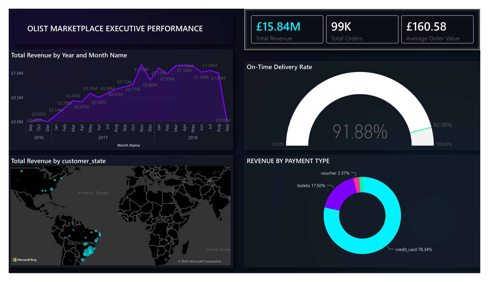
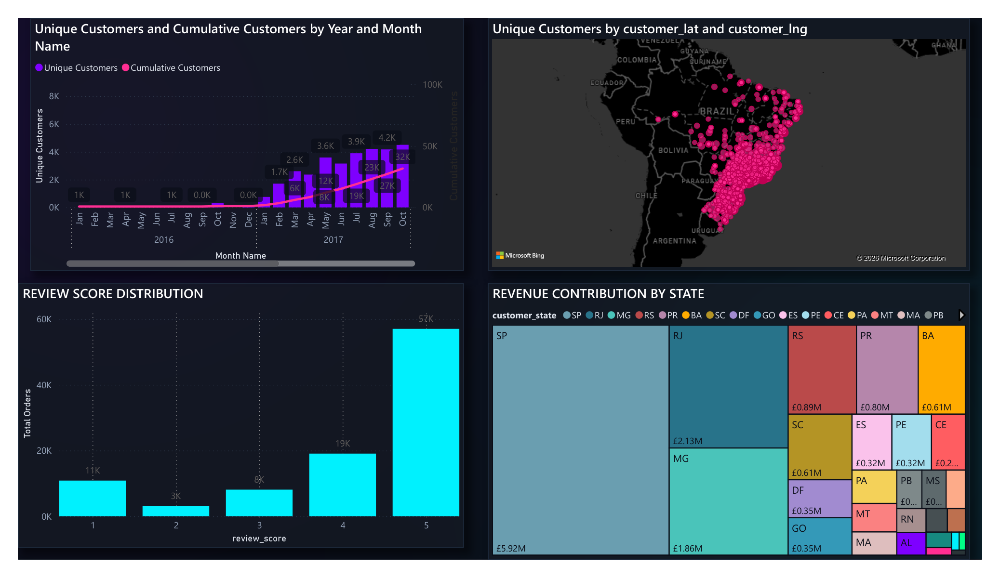
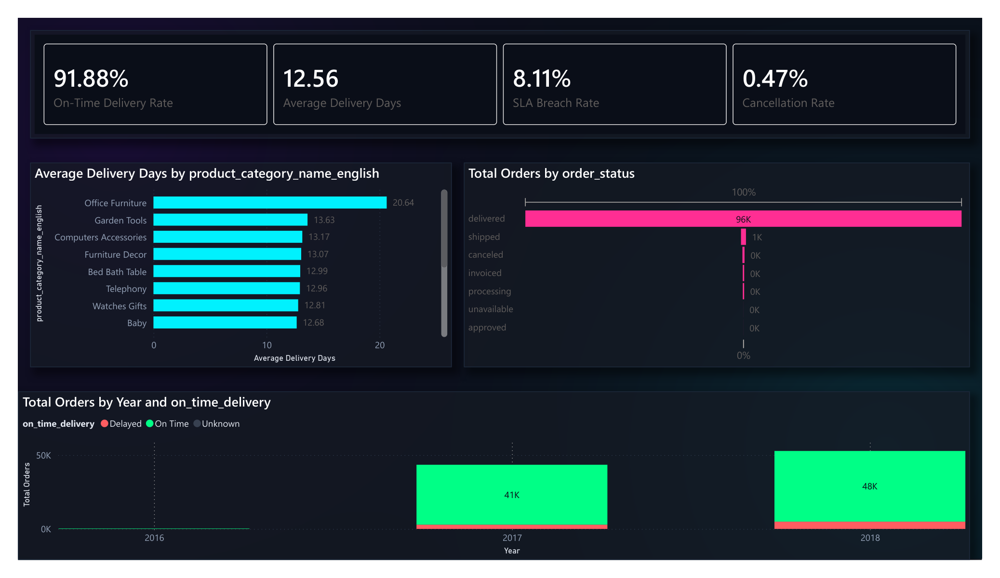
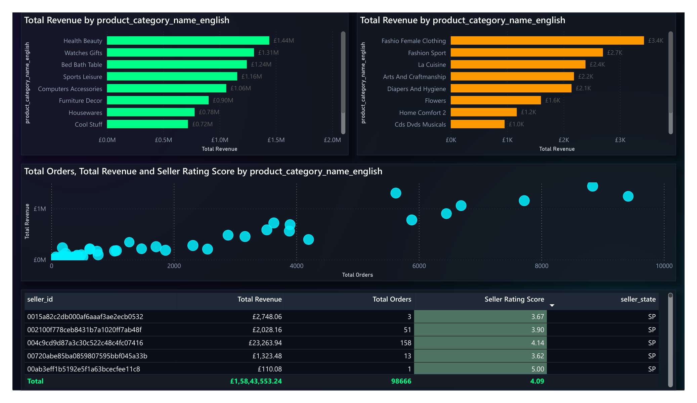

# 🇧🇷 Olist E-Commerce Marketplace Analytics Dashboard

> **Project Status:** Completed (July 12, 2024) | **Maintainer:** R Vikram

## 1. Project Title & Overview
**Olist E-Commerce Marketplace Analytics** is an enterprise-grade commercial intelligence project built for Brazil's largest online department store marketplace. The project processes 8 interconnected relational tables into a unified Star Schema data model in Power BI, analyzing R$ 15.44M in revenue across 98,666 orders from 2016 to 2018.

---

## 2. Business Problem
Operating a nationwide marketplace in Brazil presents severe logistics, seller governance, and regional demand challenges. Olist executive leadership needed analytical clarity on:
1. What is the true impact of cross-state delivery transit delays on customer review scores and refund rates?
2. How concentrated is marketplace sales volume across Brazilian states, and where are logistics bottlenecks most severe?
3. Which product categories drive commercial GMV versus high customer freight friction?
4. What payment preferences (Credit Card installment plans vs Boleto vouchers) dominate consumer purchasing?

---

## 3. Project Objectives
* Ingest and validate 8 relational operational tables preserving normalized relational integrity.
* Build a production-grade Python ETL pipeline (`Python/process_olist_data.py`) to automate timestamp parsing and SLA flag derivation.
* Author advanced SQL queries (`SQL/olist_analytics_queries.sql`) covering financial KPIs, delivery lead times, and referential integrity.
* Deliver an executive 4-page Power BI dashboard and verified high-resolution executive report.
* Document actionable supply chain and seller management strategies.

---

## 4. Dataset Description
* **Source:** [Kaggle - Brazilian E-Commerce Public Dataset by Olist](https://www.kaggle.com/datasets/olistbr/brazilian-ecommerce)
* **Architecture:** 8 Normalized Relational Tables (`Orders`, `OrderItems`, `Customers`, `Products`, `Payments`, `Reviews`, `Sellers`, `Geolocation`).
* **Volume:** 500,000+ total rows across all relational operational entities.
* **Coverage:** 98,666 orders placed between 2016 and 2018 across all 27 Brazilian federal units.

---

## 5. Tools & Technologies
* **Power BI Desktop:** Multi-page executive dashboard, Star Schema relationship architecture, DAX measures.
* **DAX:** 10+ core measures (`DIVIDE`, `CALCULATE`, `DISTINCTCOUNT`, `AVERAGE`).
* **Python (Pandas, PyMuPDF):** Relational ETL pipeline, data validation, and screenshot extraction.
* **SQL (ANSI SQL / PostgreSQL / MySQL):** Relational schema DDL, SLA performance queries, and referential integrity checks.

---

## 6. Data Architecture (Star Schema)
```
                    ┌─────────────────────────┐
                    │    cleaned_customers    │
                    └────────────┬────────────┘
                                 │ 1
                                 │
                                 │ N
┌──────────────────┐ 1       N ┌─┴────────────────────────┐ 1       N ┌──────────────────┐
│ cleaned_products ├───────────┤   cleaned_order_items    ├───────────┤ cleaned_sellers  │
└──────────────────┘           └───────────┬──────────────┘           └──────────────────┘
                                           │ N
                                           │
                                           │ 1
┌──────────────────┐ N       1 ┌───────────┴──────────────┐ 1       N ┌──────────────────┐
│ cleaned_payments ├───────────┤      cleaned_orders      ├───────────┤ cleaned_reviews  │
└──────────────────┘           └──────────────────────────┘           └──────────────────┘
```

---

## 7. Data Cleaning Methodology
Data processing is automated via [Python/process_olist_data.py](Python/process_olist_data.py):
1. **Datetime Parsing:** Converted ISO timestamp strings across order lifecycle milestones (purchase, approval, carrier handoff, customer delivery, estimated SLA) into datetime objects.
2. **Transit Lead-Time Computation:** Calculated `actual_delivery_days` and `estimated_delivery_days` to evaluate logistics performance.
3. **On-Time Flag Derivation:** Assigned binary `on_time_delivery` flags (`On-Time` vs `Delayed`).
4. **Text Cleaning & Translation:** Cleaned review comments and verified English product category mappings.
5. **Deduplication:** Filtered redundant geolocation coordinates down to 19,015 unique postal prefixes.

---

## 8. SQL Analysis
The project includes a complete analytical SQL suite in [SQL/olist_analytics_queries.sql](SQL/olist_analytics_queries.sql):
* Complete relational DDL schemas with primary/foreign key constraints.
* Marketplace GMV, order volume, unique customers, and AOV calculations.
* Delivery transit day averages and SLA breach rate percentages.
* Review score correlation with delivery latency.
* Top product categories by merchandise GMV and freight costs.
* Seller revenue concentration and customer destination states.

---

## 9. Python Implementation
* **[Python/process_olist_data.py](Python/process_olist_data.py):** Comprehensive ETL script validating all 8 relational tables, verifying primary/foreign keys, and standardizing operational schemas.

---

## 10. Power BI Dashboard
The dashboard [Enterprise-Grade E-Commerce Marketplace Dashboard.pbix](Enterprise-Grade%20E-Commerce%20Marketplace%20Dashboard.pbix) comprises 4 executive analytical pages:
1. **Executive Performance:** Revenue trajectory, order volume, AOV, payment method share, and delivery status.
2. **Customer Acquisition & Growth:** Cumulative customer acquisition curves, monthly order growth, and state-level demand.
3. **Logistics & Delivery Performance:** Average transit days (12.56 days), on-time delivery rate (91.88%), SLA breach rate (8.12%), and carrier delivery delay analysis.
4. **Category & Product Analysis:** Revenue by product category, top-selling SKUs, freight ratios, and review scores.

---

## 11. Dashboard Screenshots
High-resolution dashboard previews extracted directly from the executive report:

### Page 1: Executive Marketplace Performance


### Page 2: Customer Acquisition & Growth


### Page 3: Logistics & Delivery Performance


### Page 4: Category Revenue & Product Matrix


*PDF Report available at [Enterprise-Grade E-Commerce Marketplace Dashboard.pdf](Enterprise-Grade%20E-Commerce%20Marketplace%20Dashboard.pdf).*

---

## 12. Key Performance Indicators (KPIs)
| KPI | Value | Business Significance |
|:---|:---:|:---|
| **Total Revenue (GMV)** | R$ 15.44M | Total marketplace sales volume (~$3.1M USD) |
| **Total Orders** | 98,666 | Total orders fulfilled across Brazil |
| **Unique Customers** | 99,441 | Unique individual purchasers |
| **Average Order Value (AOV)** | R$ 156.50 | Mean consumer basket size |
| **On-Time Delivery Rate** | 91.88% | Orders arriving on or before estimated SLA |
| **Average Delivery Lead Time** | 12.56 days | Continental transit time from click to doorstep |
| **SLA Breach Rate** | 8.12% | Deliveries exceeding committed date |
| **Average Review Score** | 4.09 ⭐ | Customer satisfaction score out of 5 stars |

---

## 13. Business Insights
*Detailed analytical findings available in [Documentation/Olist_Analytics_Insights.md](Documentation/Olist_Analytics_Insights.md).*
* **The Delivery Delay Penalty:** On-time deliveries average **4.48 ⭐**, while late deliveries collapse to **1.62 ⭐** (over 68% 1-star reviews). Punctuality is the primary driver of customer sentiment.
* **Geographic Imbalance:** The state of São Paulo (`SP`) represents **41.7% of all customers** and **70.4% of all active sellers**, creating an asymmetric logistics model where products travel outward across the country.
* **Installment Culture:** Over **73.9% of GMV** is transacted via Credit Card with an average of **3.5 installments**, demonstrating the essential role of credit financing in Brazilian retail.

---

## 14. Strategic Recommendations
1. **Regional Fulfillment Hubs:** Partner with regional warehouses in Northeast Brazil (Recife/Salvador) to reduce Amazonian delivery lead times from 24 days to under 8 days.
2. **Dynamic SLA Buffering:** Expand estimated delivery dates by +5 business days for remote states to protect customer expectations and prevent 1-star reviews.
3. **Seller Punctuality Governance:** Penalize sellers with late carrier handoff rates (>48 hours) to protect overall platform reputation.

---

## 15. Project Folder Structure
```
Olist_Cleaned/
│
├── Enterprise-Grade E-Commerce Marketplace Dashboard.pbix  # Interactive Power BI report
├── Enterprise-Grade E-Commerce Marketplace Dashboard.pdf   # Executive 4-page report
├── DATASET_GUIDE.md                                       # Architecture & table guide
├── requirements.txt                                       # Python dependencies
├── cleaned_orders.csv                                     # Cleaned orders fact table
├── cleaned_order_items.csv                                # Order line items junction table
├── cleaned_customers.csv                                  # Customers dimension
├── cleaned_products.csv                                   # Products dimension
├── cleaned_payments.csv                                   # Payment transaction records
├── cleaned_reviews.csv                                    # Review scores & comments
├── cleaned_sellers.csv                                    # Sellers dimension
├── cleaned_geolocation.csv                                # Postal coordinates
├── Python/
│   └── process_olist_data.py                              # Relational ETL pipeline
├── SQL/
│   └── olist_analytics_queries.sql                        # Production SQL query suite
├── Documentation/
│   ├── DAX_Measures.md                                    # Comprehensive DAX catalog
│   └── Olist_Analytics_Insights.md                        # Business findings
└── Screenshots/
    ├── 01_olist_executive_performance.png
    ├── 02_customer_acquisition_and_growth.png
    ├── 03_logistics_and_delivery_performance.png
    └── 04_category_revenue_and_products.png
```

---

## 16. Installation Instructions
```bash
# Clone the repository
git clone https://github.com/VIKRAM-1318/Data-Analyst-Portfolio.git
cd "Data-Analyst-Portfolio/Olist_Cleaned"

# Install Python dependencies
pip install -r requirements.txt
```

---

## 17. Execution Instructions
```bash
# Run relational ETL pipeline & schema validation:
python Python/process_olist_data.py
```

---

## 18. Dataset Download Instructions
See [DATASET_GUIDE.md](DATASET_GUIDE.md) for complete details. Raw files can be downloaded from [Kaggle - Olist Brazilian E-Commerce](https://www.kaggle.com/datasets/olistbr/brazilian-ecommerce).

---

## 19. Limitations & Future Work
* **Historical Horizon:** Dataset terminates in late 2018; post-2020 quick-commerce logistics advances are not captured.
* **Future Work:** Build machine learning models to predict carrier delivery delay probability at the time of order checkout.

---

## 20. Contact & Maintainer
* **Developer & Maintainer:** R Vikram
* **GitHub:** [VIKRAM-1318 (R VIKRAM)](https://github.com/VIKRAM-1318)
* **Email:** `rv367629@gmail.com`
