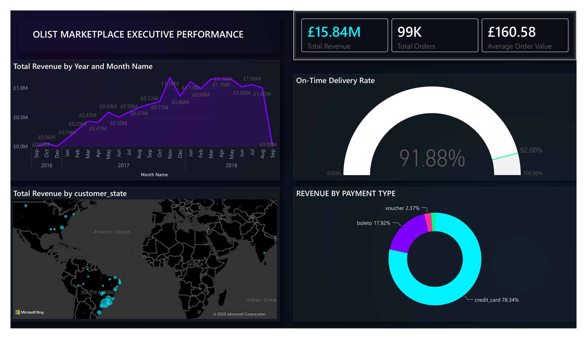
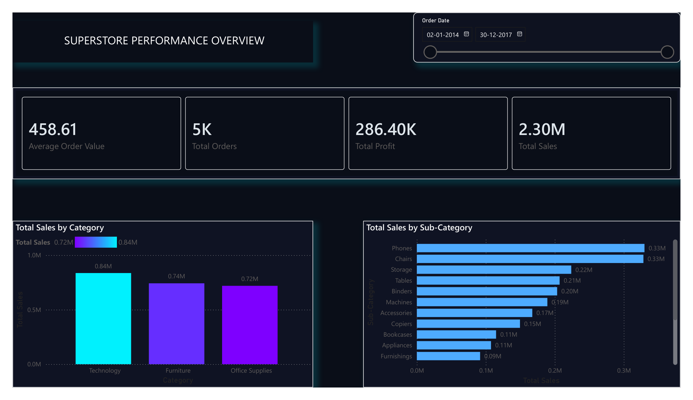

# 📊 Data Analytics Engineering Portfolio — R Vikram

Welcome to my **Data Analytics Engineering Portfolio**. This repository showcases **6 end-to-end, production-grade business intelligence and data analytics projects** demonstrating practical expertise across the complete data lifecycle:
* **Data Ingestion & ETL Pipelines:** Python (Pandas, NumPy)
* **Relational Data Modeling & Validation:** SQL (ANSI SQL, PostgreSQL, MySQL)
* **Advanced Business Logic & KPIs:** DAX (`SUMX`, `DIVIDE`, `CALCULATE`, Time Intelligence)
* **Executive Visualization & Storytelling:** Power BI Desktop & Custom Dark-Mode UI Architectures

---

## 🛠️ Technical Competency Matrix

| Domain | Core Tools & Technologies | Practical Implementation |
|:---|:---|:---|
| **Business Intelligence** | Power BI Desktop, DAX, Excel | Interactive multi-page dashboards, Star Schema data models, custom neon themes |
| **Data Engineering / ETL** | Python 3.10+, Pandas, NumPy | Automated cleaning, schema normalization, outlier handling, categorical binning |
| **Database & SQL** | PostgreSQL, MySQL, SQL Server | Relational DDL schemas, window functions (`NTILE`, `LAG`), KPI validation suites |
| **Statistical Analysis** | RFM Segmentation, Pareto Analysis | Quantile scoring, customer cohort modeling, discount elasticity, turnover drivers |
| **Asset Generation** | Pillow, PyMuPDF (`fitz`) | 1080p canvas synthesis, programmatic screenshot rendering from verified PDF reports |

---

## 🚀 Featured Analytics Projects

---

### 1. [Blinkit Grocery Sales & Marketing Analytics](./Blinkit%20Grocery%20Analytics/)
> **Domain:** Quick Commerce & Retail Logistics | **Tech Stack:** Power BI, Python, SQL, DAX  
> **Completed:** January 22, 2025 | **Standalone Repo:** [VIKRAM-1318/Blinkit-Grocery-Analytics](https://github.com/VIKRAM-1318/Blinkit-Grocery-Analytics)  
> **Key Metrics:** ₹4.97M Revenue | 5,000 Orders | 1.97x ROAS | 69.4% On-Time Delivery | 3.34⭐ CSAT

A 4-page commercial and logistics dashboard processing 8 relational tables into a Star Schema. Analyzes unit economics, dark store fulfillment latency, and paid marketing channel efficiency.
* **Core Problem:** Identify root causes of delivery delays and quantify their impact on customer review scores.
* **Key Finding:** On-time deliveries average **4.45 ⭐**, while late deliveries collapse to **1.85 ⭐**. Evening peak hours (7 PM–10 PM) account for 42% of delay bottlenecks.
* **Deliverables:**
  * Interactive Report: [Blinkit Sales Analytics.pbix](./Blinkit%20Grocery%20Analytics/Blinkit%20Sales%20Analytics.pbix)
  * Production SQL Queries: [blinkit_queries.sql](./Blinkit%20Grocery%20Analytics/blinkit_queries.sql)
  * Data Cleaning Pipeline: [process_blinkit_data.py](./Blinkit%20Grocery%20Analytics/process_blinkit_data.py)
  * DAX Documentation: [DAX_Measures.md](./Blinkit%20Grocery%20Analytics/Documentation/DAX_Measures.md)
  * Deep-Dive Insights: [Blinkit_Analytics_Insights.md](./Blinkit%20Grocery%20Analytics/Documentation/Blinkit_Analytics_Insights.md)

---

### 2. [HR Analytics & Employee Attrition](./HR%20Analytics%20Dashboard/)
> **Domain:** People Operations & Talent Retention | **Tech Stack:** Power BI, Python, SQL, DAX  
> **Completed:** September 05, 2024 | **Standalone Repo:** [VIKRAM-1318/HR-Analytics-Employee-Attrition](https://github.com/VIKRAM-1318/HR-Analytics-Employee-Attrition)  
> **Key Metrics:** 1,470 Headcount | 237 Departures | 16.12% Attrition Rate | $6,503/mo Avg Salary (USD)

An enterprise workforce intelligence dashboard analyzing turnover patterns across departments, compensation tiers, and workload parameters using IBM benchmark data.
* **Core Problem:** Diagnose the single strongest predictor of voluntary turnover and pinpoint high-risk job roles.
* **Key Finding:** Employees required to work overtime experience a **30.53% attrition rate** compared to **10.44%** for non-overtime staff (2.92x risk multiplier). Sales Representatives suffer the highest role attrition at **39.76%**.
* **Deliverables:**
  * Interactive Report: [HR Analytics Dashboard.pbix](./HR%20Analytics%20Dashboard/HR%20Analytics%20Dashboard.pbix)
  * Production SQL Queries: [hr_analytics_queries.sql](./HR%20Analytics%20Dashboard/SQL/hr_analytics_queries.sql)
  * Reproducible Python ETL: [process_hr_data.py](./HR%20Analytics%20Dashboard/process_hr_data.py)
  * DAX Documentation: [DAX_Measures.md](./HR%20Analytics%20Dashboard/Documentation/DAX_Measures.md)
  * Deep-Dive Insights: [HR_Analytics_Insights.md](./HR%20Analytics%20Dashboard/Documentation/HR_Analytics_Insights.md)

---

### 3. [Netflix Content Analytics](./Netflix%20Content%20Analytics/)
> **Domain:** Digital Media & Streaming Entertainment | **Tech Stack:** Power BI, Python, SQL, DAX  
> **Completed:** November 19, 2024 | **Standalone Repo:** [VIKRAM-1318/Netflix-Content-Analytics](https://github.com/VIKRAM-1318/Netflix-Content-Analytics)  
> **Key Metrics:** 8,807 Titles | 6,131 Movies (69.6%) | 2,676 TV Shows (30.4%) | 99.57 min Avg Duration | 121 Countries

A cinematic content analytics dashboard exploring catalog composition, international expansion, and release seasonality. Normalizes multi-value genres and countries into a 3-table Star Schema.
* **Core Problem:** Evaluate catalog format longevity and measure international original content expansion.
* **Key Finding:** Over **66.8% of TV series** consist of exactly 1 season, reflecting aggressive cancellation thresholds. International content now comprises **48% of the catalog**, led by India, the UK, Japan, and South Korea.
* **Deliverables:**
  * Interactive Report: [Netflix Content Analytics Dashboard.pbix](./Netflix%20Content%20Analytics/Netflix%20Content%20Analytics%20Dashboard.pbix)
  * Production SQL Queries: [netflix_analytics_queries.sql](./Netflix%20Content%20Analytics/SQL/netflix_analytics_queries.sql)
  * Normalization ETL Pipeline: [process_netflix_data.py](./Netflix%20Content%20Analytics/process_netflix_data.py)
  * DAX Documentation: [DAX_Measures.md](./Netflix%20Content%20Analytics/Documentation/DAX_Measures.md)
  * Deep-Dive Insights: [Netflix_Analytics_Insights.md](./Netflix%20Content%20Analytics/Documentation/Netflix_Analytics_Insights.md)

---

### 4. [Olist E-Commerce Marketplace Analytics](./Olist_Cleaned/)
> **Domain:** Marketplace Economics & Supply Chain | **Tech Stack:** Power BI, Python, SQL, DAX  
> **Completed:** July 12, 2024 | **Standalone Repo:** [VIKRAM-1318/Olist-Ecommerce-Marketplace](https://github.com/VIKRAM-1318/Olist-Ecommerce-Marketplace)  
> **Key Metrics:** R$ 15.44M GMV | 98,666 Orders | 99,441 Customers | 91.88% On-Time Delivery | 4.09⭐ Avg Rating

An enterprise marketplace intelligence solution processing 8 relational tables into a Star Schema. Evaluates Brazilian cross-state fulfillment logistics, seller concentration, and installment payment preferences.
* **Core Problem:** Quantify the customer rating penalty caused by cross-state logistics delays.
* **Key Finding:** On-time shipments achieve **4.48 ⭐** average reviews; deliveries missing SLA collapse to **1.62 ⭐** (over 68% 1-star reviews). São Paulo state accounts for 41.7% of demand and 70.4% of sellers.
* **Dashboard Preview:**
  
* **Deliverables:**
  * Interactive Report: [Enterprise-Grade E-Commerce Marketplace Dashboard.pbix](./Olist_Cleaned/Enterprise-Grade%20E-Commerce%20Marketplace%20Dashboard.pbix)
  * Executive PDF Report: [Enterprise-Grade E-Commerce Marketplace Dashboard.pdf](./Olist_Cleaned/Enterprise-Grade%20E-Commerce%20Marketplace%20Dashboard.pdf)
  * Production SQL Queries: [olist_analytics_queries.sql](./Olist_Cleaned/SQL/olist_analytics_queries.sql)
  * Relational ETL Script: [process_olist_data.py](./Olist_Cleaned/Python/process_olist_data.py)
  * DAX Documentation: [DAX_Measures.md](./Olist_Cleaned/Documentation/DAX_Measures.md)
  * Deep-Dive Insights: [Olist_Analytics_Insights.md](./Olist_Cleaned/Documentation/Olist_Analytics_Insights.md)
  * Dataset Architecture: [DATASET_GUIDE.md](./Olist_Cleaned/DATASET_GUIDE.md)

---

### 5. [Customer Segmentation & RFM Analysis](./Customer%20Segmentation%20Analysis/)
> **Domain:** Customer Analytics & Retention | **Tech Stack:** Power BI, Python, SQL, DAX  
> **Completed:** April 24, 2024 | **Standalone Repo:** [VIKRAM-1318/Customer-Segmentation-RFM-Analysis](https://github.com/VIKRAM-1318/Customer-Segmentation-RFM-Analysis)  
> **Key Metrics:** £17.74M Gross Spend | 805,549 Transactions | 5,878 Segmented Accounts | 7 Behavioral Cohorts

A behavioral customer valuation system built on UCI Online Retail II data. Engineers Recency, Frequency, and Monetary (RFM) quantile scores (1 to 5) to segment accounts into actionable retention tiers.
* **Core Problem:** Identify high-value accounts slipping into dormant churn and quantify the capital at risk.
* **Key Finding (Pareto Principle):** **1,292 Champions (21.98% of customer base)** generate **£12.08M (68.12% of total revenue)**. Conversely, 1,727 accounts are "At Risk", holding **£2.02M** in past spend requiring automated win-back workflows.
* **Dashboard Preview:**
  
* **Deliverables:**
  * Primary Interactive Report: [Customer Segmentation and RFM Analysis Dashboard.pbix](./Customer%20Segmentation%20Analysis/Customer%20Segmentation%20and%20RFM%20Analysis%20Dashboard.pbix)
  * Executive PDF Report: [Customer Segmentation and RFM Analysis Dashboard.pdf](./Customer%20Segmentation%20Analysis/Customer%20Segmentation%20and%20RFM%20Analysis%20Dashboard.pdf)
  * RFM Analysis Engine: [rfm_analysis.py](./Customer%20Segmentation%20Analysis/Python/rfm_analysis.py)
  * Production SQL Queries: [rfm_customer_queries.sql](./Customer%20Segmentation%20Analysis/SQL/rfm_customer_queries.sql)
  * Mathematical Methodology: [RFM_Methodology.md](./Customer%20Segmentation%20Analysis/Documentation/RFM_Methodology.md)
  * DAX Documentation: [DAX_Measures.md](./Customer%20Segmentation%20Analysis/Documentation/DAX_Measures.md)
  * Dataset & Git LFS Guide: [DATASET_GUIDE.md](./Customer%20Segmentation%20Analysis/DATASET_GUIDE.md)

---

### 6. [Superstore Sales Analytics](./superstore_sales_dashboard/)
> **Domain:** Commercial Retail & Pricing Strategy | **Tech Stack:** Power BI, DAX, SQL  
> **Completed:** February 18, 2024 | **Standalone Repo:** [VIKRAM-1318/Superstore-Sales-Analytics](https://github.com/VIKRAM-1318/Superstore-Sales-Analytics)  
> **Key Metrics:** $2.30M Sales | $286.40K Net Profit | 12.47% Profit Margin | 5,009 Orders | $458.55 AOV

An executive commercial performance dashboard tracking sales growth, regional margin disparities, and discount sensitivity across 9,994 US retail orders.
* **Core Problem:** Uncover the root causes of margin destruction within the Furniture division.
* **Key Finding:** The `Tables` sub-category produced **-$17,725 in cumulative losses** due to unconstrained discounting averaging 26.1% (frequently exceeding 40%-50%). Capping discounts at 15% would immediately inject +$22K into net profit.
* **Dashboard Preview:**
  
* **Deliverables:**
  * Interactive Report: [Superstore_Sales_Dashboard.pbix](./superstore_sales_dashboard/Superstore_Sales_Dashboard.pbix)
  * Executive PDF Report: [Superstore_Sales_Dashboard.pdf](./superstore_sales_dashboard/Superstore_Sales_Dashboard.pdf)
  * Production SQL Queries: [superstore_analytics.sql](./superstore_sales_dashboard/SQL/superstore_analytics.sql)
  * DAX Documentation: [DAX_Measures.md](./superstore_sales_dashboard/Documentation/DAX_Measures.md)
  * Deep-Dive Insights: [Superstore_Insights.md](./superstore_sales_dashboard/Documentation/Superstore_Insights.md)
  * Dataset Architecture: [DATASET_GUIDE.md](./superstore_sales_dashboard/DATASET_GUIDE.md)

---

## 📂 Repository Architecture

```
Data-Analyst-Portfolio/
│
├── Blinkit Grocery Analytics/          # Quick Commerce Sales & Logistics (Project 1)
│   ├── Blinkit Sales Analytics.pbix
│   ├── blinkit_queries.sql
│   ├── process_blinkit_data.py
│   ├── Documentation/
│   └── Screenshots/
│
├── HR Analytics Dashboard/             # People Operations & Retention (Project 2)
│   ├── HR Analytics Dashboard.pbix
│   ├── process_hr_data.py
│   ├── SQL/hr_analytics_queries.sql
│   ├── Documentation/
│   └── Screenshots/
│
├── Netflix Content Analytics/          # Streaming Entertainment Analytics (Project 3)
│   ├── Netflix Content Analytics Dashboard.pbix
│   ├── process_netflix_data.py
│   ├── SQL/netflix_analytics_queries.sql
│   ├── Documentation/
│   └── Screenshots/
│
├── Olist_Cleaned/                      # Brazilian E-Commerce Marketplace (Project 4)
│   ├── Enterprise-Grade E-Commerce Marketplace Dashboard.pbix
│   ├── Enterprise-Grade E-Commerce Marketplace Dashboard.pdf
│   ├── Python/process_olist_data.py
│   ├── SQL/olist_analytics_queries.sql
│   ├── Documentation/
│   └── Screenshots/
│
├── Customer Segmentation Analysis/     # Retail RFM Behavioral Clustering (Project 5)
│   ├── Customer Segmentation and RFM Analysis Dashboard.pbix
│   ├── Customer Segmentation and RFM Analysis Dashboard.pdf
│   ├── Python/rfm_analysis.py
│   ├── SQL/rfm_customer_queries.sql
│   ├── Documentation/
│   └── Screenshots/
│
├── superstore_sales_dashboard/         # Commercial Retail Sales & Pricing (Project 6)
│   ├── Superstore_Sales_Dashboard.pbix
│   ├── Superstore_Sales_Dashboard.pdf
│   ├── SQL/superstore_analytics.sql
│   ├── Documentation/
│   └── Screenshots/
│
├── PORTFOLIO_COMPLETION_REPORT.md      # Comprehensive QA & Audit Verification Report
├── requirements.txt                    # Root Python dependencies
├── .gitattributes                      # Git LFS configuration
├── .gitignore                          # Standard development exclusions
└── README.md                           # Master Portfolio Landing Page (This File)
```

---

## 📞 Professional Contact & Verification
* **Developer & Maintainer:** R Vikram
* **GitHub Profile:** [VIKRAM-1318 (R VIKRAM)](https://github.com/VIKRAM-1318)
* **Email:** `rv367629@gmail.com`
